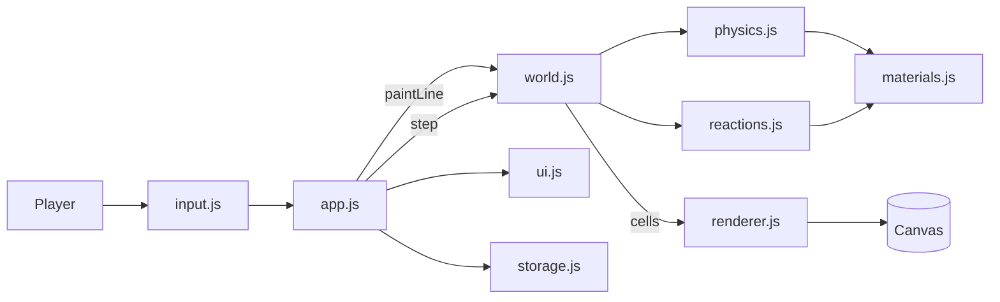

# ⏳ Sandbox

A falling-sand **physics sandbox** built with vanilla **HTML, CSS and JavaScript**. Paint with sand, water, fire, lava, acid, plants and TNT, and watch the materials pile up, flow, burn, freeze, dissolve and explode. Every grain is simulated, and the materials react with each other.

No frameworks, no libraries, no images and no network access: the whole thing works offline.

---

## Table of Contents

1. [Features](#features)
2. [How to Play](#how-to-play)
3. [Controls](#controls)
4. [Materials](#materials)
5. [Reactions](#reactions)
6. [Things to Try](#things-to-try)
7. [Tech Stack](#tech-stack)
8. [Project Structure](#project-structure)
9. [Getting Started](#getting-started)
10. [How the Simulation Works](#how-the-simulation-works)
11. [Architecture](#architecture)
12. [Configuration](#configuration)
13. [Testing](#testing)
14. [Deploying to GitHub Pages](#deploying-to-github-pages)
15. [Browser Support and Known Limitations](#browser-support-and-known-limitations)
16. [Commit History Guide](#commit-history-guide)
17. [Roadmap](#roadmap)
18. [Contributing](#contributing)
19. [License](#license)

---

## Features

- **14 tools:** Sand, Water, Stone, Wood, Fire, Oil, Plant, Lava, Ice, Acid, TNT, Smoke, Steam and an Eraser
- A real **cellular-automaton physics** engine: powders pile up, liquids flow and level out, gases rise, and heavier materials sink through lighter ones
- Materials **react with each other**: fire spreads, water extinguishes it, lava meets water, acid eats solids, plants grow, ice freezes, steam rains and TNT chain-reacts
- Brush size and simulation speed controls, plus **pause and single-step**
- Spray-style painting for sand and water, solid painting for stone, and a **brush preview** circle
- **Right-click to erase** and **Shift to paint over** other materials
- **Save and load** your world in the browser, and **export a PNG**
- Live **particle count and FPS** readout
- Mouse, touch and keyboard support, with a responsive layout
- Animated fire and shimmering lava and acid
- A simulation core with no DOM code, covered by unit tests

---

## How to Play

1. Pick a material from the palette (or press its number key).
2. Drag on the canvas to paint. Hold still to keep pouring.
3. Mix materials and watch what happens. Everything reacts!

---

## Controls

| Action                          | Mouse / Touch                | Keyboard                    |
| ------------------------------- | ---------------------------- | --------------------------- |
| Paint                           | Drag (left button or finger) |                             |
| Erase                           | Right-click and drag         | `E` selects the Eraser      |
| Paint over existing material    | Hold `Shift` while painting  |                             |
| Choose a material               | Click it in the palette      | See the hotkeys below       |
| Brush size                      | Brush slider                 | `[` smaller, `]` larger     |
| Simulation speed                | Speed slider                 |                             |
| Pause / play                    | **Pause** button             | `Space`                     |
| Advance one step (when paused)  | **Step** button              | `.`                         |
| Clear the world                 | **Clear** button             | `C`                         |
| Save / load the world           | **Save** and **Load**        |                             |
| Download a picture              | **Save PNG**                 |                             |

### Material hotkeys

| Key | Material | Key | Material | Key | Material |
| --- | -------- | --- | -------- | --- | -------- |
| `1` | Sand     | `6` | Oil      | `0` | Acid     |
| `2` | Water    | `7` | Plant    | `T` | TNT      |
| `3` | Stone    | `8` | Lava     | `S` | Smoke    |
| `4` | Wood     | `9` | Ice      | `V` | Steam    |
| `5` | Fire     | `E` | Eraser   |     |          |

---

## Materials

| Material | Type    | Behaviour                                                                   |
| -------- | ------- | --------------------------------------------------------------------------- |
| Sand     | Powder  | Falls and forms piles; sinks through liquids                                |
| Water    | Liquid  | Flows and levels out; extinguishes fire; feeds plants                       |
| Stone    | Solid   | Never moves; survives explosions; dissolved only by acid                    |
| Wood     | Solid   | Burns slowly and for a long time                                            |
| Fire     | Special | Spreads to flammable materials, flickers upwards, leaves smoke              |
| Oil      | Liquid  | Thick, lighter than water so it **floats**; burns fast                      |
| Plant    | Solid   | Grows into neighbouring water; burns                                        |
| Lava     | Liquid  | Heavy and slow; ignites things; turns water into stone                      |
| Ice      | Solid   | Slowly freezes neighbouring water; melts near fire and lava                 |
| Acid     | Liquid  | Dissolves sand, stone, wood, plants, ice and TNT, and is used up doing it   |
| TNT      | Solid   | Explodes when touched by fire or lava; blasts set off other TNT             |
| Smoke    | Gas     | Rises and fades                                                             |
| Steam    | Gas     | Rises, bubbles up through liquids, and condenses back into water            |

### Density

Heavier materials sink through lighter ones:

| Density | Materials                  |
| ------- | -------------------------- |
| 40      | Sand                       |
| 25      | Lava                       |
| 12      | Acid                       |
| 10      | Water                      |
| 8       | Oil                        |
| 1       | Smoke, Steam, Fire         |

That is why sand sinks in water, oil floats on water, and lava sinks through everything liquid.

---

## Reactions

| When this touches...        | ...this happens                                                         |
| --------------------------- | ----------------------------------------------------------------------- |
| Fire + Wood                 | Wood catches fire (slow chance, then burns for a long time)             |
| Fire + Plant                | Plant burns quickly                                                     |
| Fire + Oil                  | Oil ignites very easily                                                 |
| Fire + Water                | The fire goes out and makes steam                                       |
| Fire + Ice                  | Ice melts into water                                                    |
| Fire + TNT                  | **Explosion**                                                           |
| Lava + Water                | Lava turns to **stone**, water turns to steam                           |
| Lava + Wood / Plant / Oil   | They ignite (faster than from fire)                                     |
| Lava + Ice                  | Ice melts                                                               |
| Lava + TNT                  | **Explosion**                                                           |
| Acid + Sand / Stone / Wood / Plant / Ice / TNT | The material dissolves, and the acid may be used up  |
| Plant + Water               | The plant slowly grows into the water                                   |
| Ice + Water                 | The water very slowly freezes                                           |
| Steam (old)                 | Condenses into water, so it rains                                       |
| Smoke (old)                 | Fades away                                                              |

### TNT explosions

An explosion turns everything near its centre into fire and about half of what is further out. Water flashes into steam. **Stone is never destroyed**, so it makes a good shield. TNT inside a blast is set off as well, so a pile of TNT blows up in a chain reaction.

---

## Things to Try

- **Volcano:** build a stone cone, pour lava into it, then drop water on the lava
- **Rain forest:** dig a stone basin, add water and plants, then watch the plants spread
- **Oil fire:** pour oil on water, then ignite it. The oil burns while the water stays below
- **Acid bath:** fill a container of stone with acid and watch the walls disappear
- **Chain reaction:** stack TNT in a long line and light one end
- **Ice age:** put a single ice block in a big pool of water
- **Hourglass:** build a stone hourglass and fill the top with sand
- **Water cycle:** heat water with lava and watch the steam rise and rain back down

---

## Tech Stack

| Layer       | Technology                                  |
| ----------- | ------------------------------------------- |
| Markup      | HTML5 (semantic elements, ARIA attributes)  |
| Styling     | CSS3 (custom properties, grid)              |
| Logic       | Vanilla JavaScript (ES2015+)                |
| Rendering   | HTML5 Canvas (`ImageData`)                  |
| Persistence | Web Storage API (`localStorage`)            |
| Testing     | Node.js built-in test runner (`node:test`)  |

---

## Project Structure

```
sandbox-game/
├── index.html           # Canvas, palette and controls
├── css/
│   ├── style.css        # Theme, layout, palette, sliders, canvas
│   └── responsive.css   # Tablet, phone and reduced-motion rules
├── js/
│   ├── config.js        # World size, speeds, brush limits, explosion radius
│   ├── materials.js     # Material definitions, colors, density rules
│   ├── physics.js       # Movement: powders, liquids, gases
│   ├── reactions.js     # Fire, lava, acid, plants, ice, steam, TNT
│   ├── world.js         # The grid, the simulation step and painting
│   ├── storage.js       # Run-length saved worlds in localStorage
│   ├── renderer.js      # Draws the grid on the canvas
│   ├── input.js         # Pointer painting and keyboard shortcuts
│   ├── ui.js            # Palette, sliders, buttons and messages
│   ├── app.js           # The paint, simulate and draw loop
│   └── main.js          # Entry point
├── tests/
│   ├── helpers.js       # Shared test helpers (no tests)
│   ├── materials.test.js
│   ├── physics.test.js
│   ├── reactions.test.js
│   ├── world.test.js
│   └── storage.test.js
├── package.json
├── .gitignore
└── README.md
```

---

## Getting Started

### Prerequisites

- Any modern web browser
- (Optional) [Node.js](https://nodejs.org/) 18 or newer, only needed to run the tests

### Run it

```bash
git clone https://github.com/<your-username>/sandbox-game.git
cd sandbox-game
```

Then open `index.html`:

```bash
# Windows
start index.html
# macOS
open index.html
# Linux
xdg-open index.html
```

You can also use the VS Code **Live Server** extension, or any static server such as `python -m http.server 8000`.

---

## How the Simulation Works

The world is a **grid of 240 × 150 cells**. Each cell holds one material id. Everything is stored in flat typed arrays (`Uint8Array` for materials and shades, `Uint16Array` for lifetimes), so a whole step is a tight loop with no allocations per cell.

### One step

1. Scan the grid **from the bottom row to the top**, so a grain that falls is not processed again in the same step.
2. For every row pick a **random direction** (left to right or right to left) so nothing drifts to one side.
3. For each cell, run the update function of its material (`UPDATERS` in `world.js`). Stone, wood and TNT have none.
4. When a cell swaps with another, both are **stamped** with the step number so they are not moved a second time (this matters for gases that move upwards into rows that are scanned later).
5. Finally, process queued TNT explosions.

### Movement rules (`physics.js`)

- **Powders** fall straight down if the cell below is *sinkable*, otherwise slide diagonally down.
- **Liquids** do the same, then flow **sideways across empty cells** up to a reach distance, which is what makes water level out. Thick liquids (oil, lava) only act some of the time (`viscosity`).
- **Gases** do the opposite: they rise into empty space or bubble up through liquids, with a little random wobble.

### Density

`canSink(mover, target)` is the one rule behind sinking and floating: a material can enter a cell that is empty, or swap with a lighter liquid, gas or fire. Solids and other powders always block. No material has special-case code for water or oil: their densities do all the work.

### Reactions (`reactions.js`)

Reacting materials look at their four neighbours each step and, with a chance, change themselves or a neighbour. All chances and burn times live in `materials.js`. Fuel such as wood is turned into a long-lived fire cell, which is why logs burn for a while and spread slowly.

### Painting

`paint` fills a round area with a **spray chance** per cell (sand and water spray, stone is solid). `paintLine` uses Bresenham's line algorithm so fast mouse movements never leave gaps, and the app keeps painting every frame while the pointer is held down, so you can pour.

### Saving

Worlds are saved with **run-length encoding**: `[id, count, id, count, ...]`. An empty world is a single pair, and even a busy world is small. Loading validates every run (known material, whole positive count, exact total length) and ignores anything suspicious.

---

## Architecture

The simulation knows nothing about the page, and the page knows nothing about the simulation rules.

| Module         | Responsibility                                | Touches the DOM? |
| -------------- | --------------------------------------------- | ---------------- |
| `config.js`    | Constants                                     | No               |
| `materials.js` | What every material is, and the density rule  | No               |
| `physics.js`   | How powders, liquids and gases move           | No               |
| `reactions.js` | How materials interact                        | No               |
| `world.js`     | The grid, painting and the simulation step    | No               |
| `storage.js`   | Encode, validate, save and load worlds        | No               |
| `renderer.js`  | Draw the grid                                 | Canvas only      |
| `input.js`     | Pointer and keyboard events                   | Yes              |
| `ui.js`        | Palette, sliders, buttons and messages        | Yes              |
| `app.js`       | The main loop and the controls                | Via other modules|
| `main.js`      | Create objects and attach listeners           | Yes              |

Each file is wrapped in an IIFE and exports through `module.exports` (Node) or the `window.Sandbox` namespace (browser). This avoids ES modules, which browsers block when a page is opened from `file://`.

### Data flow



### The frame loop

```
every frame:
  1. paint      if a pointer is pressed, paint a line from the last position
  2. simulate   run `speed` steps (unless paused)
  3. draw       turn the cells into colors and put them on the canvas
```

---

## Configuration

Everything adjustable is in `js/config.js`:

| Setting               | Default | Description                                       |
| --------------------- | ------- | ------------------------------------------------- |
| `WIDTH`, `HEIGHT`     | 240, 150 | World size in cells                              |
| `STEPS_PER_FRAME`     | `2`     | Default simulation speed                          |
| `MAX_STEPS_PER_FRAME` | `4`     | Fastest speed on the slider                       |
| `BRUSH_MIN` / `MAX` / `DEFAULT` | 1 / 12 / 3 | Brush size range                      |
| `EXPLOSION_RADIUS`    | `7`     | TNT blast radius in cells                         |
| `MAX_BLASTS_PER_STEP` | `40`    | Chain-reaction explosions handled per step        |

Material behaviour (density, viscosity, colors, flammability, lifetimes, spray chance) is in `js/materials.js`.

### Adding a new material

1. Add an entry to `MATERIALS` (and an id to `IDS`) in `materials.js`.
2. If it should move, assign `Physics.updatePowder`, `updateLiquid` or `updateGas` to it in `UPDATERS` in `world.js`.
3. If it reacts, write an update function in `reactions.js`.
4. It appears in the palette once its id is added to `DISPLAY_ORDER`.

---

## Testing

The simulation and storage are covered by unit tests using Node's built-in test runner, so there is nothing to install:

```bash
npm test
```

(or simply `node --test`)

| Test file             | What it covers                                                                              |
| --------------------- | ------------------------------------------------------------------------------------------- |
| `materials.test.js`   | Valid colors and hotkeys, density rules, flammability, random lifetimes                     |
| `physics.test.js`     | Falling, piling, sinking, levelling, floating, rising gases, solids staying put, conservation, a fuzz run |
| `reactions.test.js`   | Burning, spreading fire, extinguishing, melting, lava and water, plants, freezing, acid, condensing, explosions, chain reactions |
| `world.test.js`       | Reading and writing cells, painting shapes, overwrite, eraser, spray chance, line drawing, clear and load |
| `storage.test.js`     | Encoding, decoding, rejecting bad data, save and load, missing storage                      |

### Making reactions testable

Reactions are random ("a 2% chance per step"), which makes tests flaky. The tests give the world a random source that **always returns 0**, so every chance succeeds and the outcome is completely predictable. Longer-running behaviour (piling, levelling, plant growth) uses a **seeded** random generator, so a run is the same every time.

### Conservation tests

Two tests check that **sand and water are never created or destroyed** while they move around, and that a world filled with every material still runs without errors and never contains an invalid material id.

### Debugging in the browser

```js
sandbox.world.count(2)           // how much water (see IDS in materials.js)
sandbox.world.particleCount()
sandbox.speed = 4
```

---

## Deploying to GitHub Pages

Because this is a static site, deployment is free:

1. Push the repository to GitHub.
2. Go to **Settings → Pages**.
3. Under **Build and deployment**, choose **Deploy from a branch**.
4. Select the `main` branch and the `/ (root)` folder, then save.
5. After a minute the sandbox is live at `https://<your-username>.github.io/sandbox-game/`.

---

## Browser Support and Known Limitations

Works in current versions of Chrome, Edge, Firefox and Safari on desktop and mobile. It needs Canvas, typed arrays, pointer events and `calc()`. The sandbox still runs without `localStorage`; it just cannot save worlds.

- The world is fixed at 240 × 150 cells. Very large worlds would need a faster engine.
- Fluids are simple cellular automata, not true fluid dynamics, so liquids can look slightly "jittery" while settling.
- Saved worlds store materials only. Fire and steam lifetimes restart when a world is loaded.
- Saved worlds only load into a world of the same size they were saved from.
- The simulation speed depends on the frame rate: on a very slow device, lower the **Speed** slider.

---

## Commit History Guide

The project was built module by module, one commit per step:

| #  | Type    | What it added                                                          |
| -- | ------- | ---------------------------------------------------------------------- |
| 1  | `chore` | Repository initialization, `.gitignore` and `package.json`             |
| 2  | `docs`  | Initial README skeleton                                                |
| 3  | `feat`  | HTML structure: canvas, palette and controls                           |
| 4  | `style` | Theme, layout, palette, sliders and canvas styles                      |
| 5  | `feat`  | Sandbox configuration                                                  |
| 6  | `feat`  | Material definitions, colors and the density rule                      |
| 7  | `feat`  | Movement physics for powders, liquids and gases                        |
| 8  | `feat`  | Reactions: fire, lava, acid, plants, ice, steam and TNT                |
| 9  | `feat`  | The `World` grid, simulation step and painting                         |
| 10 | `test`  | Tests for materials, physics, reactions and the world                  |
| 11 | `feat`  | Run-length encoded saving, with tests                                  |
| 12 | `feat`  | Canvas renderer                                                        |
| 13 | `feat`  | Pointer painting and keyboard shortcuts                                |
| 14 | `feat`  | UI module                                                              |
| 15 | `feat`  | App controller and frame loop                                          |
| 16 | `feat`  | Entry point                                                            |
| 17 | `style` | Responsive layout                                                      |
| 18 | `docs`  | This detailed README                                                   |

Commit messages follow the [Conventional Commits](https://www.conventionalcommits.org/) style.

---

## Roadmap

- [ ] Wind and gravity controls
- [ ] More materials: gunpowder, salt, metal, glass, snow, seeds
- [ ] Heat as a real value, so metal can glow and water can boil
- [ ] Material emitters (a tap that keeps pouring)
- [ ] Undo for brush strokes
- [ ] Bigger worlds and a zoom control
- [ ] Share a world through a link
- [ ] Sound effects

---

## Contributing

Contributions are welcome.

1. Fork the repository
2. Create a feature branch: `git checkout -b feat/my-feature`
3. Make your changes and run `npm test`
4. Commit with a clear message: `git commit -m "feat: describe your change"`
5. Push and open a Pull Request

---

## License

This project does not include a license file, all rights are reserved.